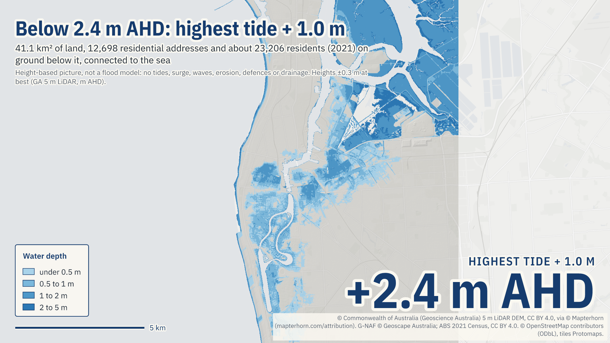
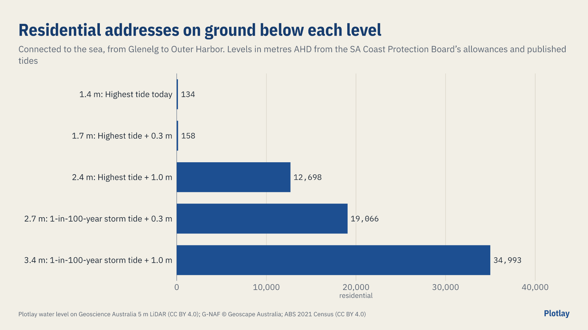

# What sits below the water line on Adelaide's coast?

Port Adelaide, the LeFevre Peninsula, West Lakes, Semaphore and Glenelg sit low, and parts were built on reclaimed tidal flats and swamp. This repository counts the land, addresses, residents and roads on ground below a level of still water that the sea could reach, at levels from published tides and the SA Coast Protection Board's allowances for sea level rise, from Glenelg to Outer Harbor. **Live version, with an interactive map:** [getplotlay.com/showcase/adelaide-sea-level](https://www.getplotlay.com/showcase/adelaide-sea-level/)

At **2.4 m AHD**, the highest tide at Outer Harbor plus the Board's 1.0 m allowance to 2100, the heights put **41.1 km² of land and 12,698 residential addresses** (about 23,206 residents in 2021) on ground below the line and reachable from the sea. At **3.4 m**, the 1-in-100-year storm tide plus 1.0 m, it is 34,993.

[Plotlay](https://www.getplotlay.com) works this out on a value map of heights with its Water level tool: connected to the sea, with the levels named on the slider and the addresses and residents counted under each.

## What this is, and is not

- **A height-based picture, not a flood or coastal model.** It shows ground below a level of still water that the sea could reach. It leaves out tides rising and falling, storm surge, waves, erosion, sea walls and levees the heights do not show, and drainage, including water backing up through stormwater pipes.
- **The levels are planning figures and tides, not predictions.** A storm tide lasts hours; still water filling the land to its full height is the most it could be. The run from 0 to 10 m is an illustration of the shape of the land.
- **Below the line is not under water.** Much of this coast is behind sea walls, levees, dunes, tidal gates and pumps, some too narrow for 5 m heights to see.
- **An address is not a person or a building.** Residents are each ABS mesh block's 2021 Census count, shared by the part of its ground below the level.

## The levels

Heights are metres above the Australian Height Datum (AHD), close to mean sea level (at Outer Harbor the sea today averages about 0.05 m below AHD zero).

| Level | What it is | How it is worked out |
|---|---|---|
| 1.4 m | Highest tide today | Highest astronomical tide at Outer Harbor: 2.847 m above the port's chart datum (lowest astronomical tide), which is 1.452 m below AHD, so 1.395 m AHD, rounded to 1.4. [Source](https://www.sma.sa.gov.au/wp-content/uploads/Glenelg-MarinoSMP2014_WEB.pdf) |
| 1.7 m | Highest tide + 0.3 m | The highest tide plus the Coast Protection Board's 0.3 m allowance for sea level rise to 2050. [Source](https://cdn.environment.sa.gov.au/environment/docs/CPB-Policy-October-2022.pdf) |
| 2.4 m | Highest tide + 1.0 m | The highest tide plus the Board's 1.0 m allowance to 2100. [Source](https://cdn.environment.sa.gov.au/environment/docs/CPB-Policy-October-2022.pdf) |
| 2.7 m | 1-in-100-year storm tide + 0.3 m | The 1% AEP (1-in-100-year) still water storm tide for the metropolitan coast, 2.4 m AHD, plus 0.3 m: the basis of the Board's standard for building sites to 2050 (before any local adjustment for subsidence). Wave setup and run-up are not in it. [Source](https://cdn.environment.sa.gov.au/environment/docs/alb_technical_report.pdf) |
| 3.4 m | 1-in-100-year storm tide + 1.0 m | The same storm tide plus the Board's 1.0 m to 2100. [Source](https://cdn.environment.sa.gov.au/environment/docs/CPB-Policy-October-2022.pdf) |

## Below each level

| Level | | Land | Residential addresses | All addresses | Residents (2021) | Roads |
|---|---|---:|---:|---:|---:|---:|
| 1.4 m | Highest tide today | 20.6 km² | 134 | 1,038 | 227 | 2 km |
| 1.7 m | Highest tide + 0.3 m | 22.3 km² | 158 | 1,181 | 256 | 17 km |
| 2.4 m | Highest tide + 1.0 m | 41.1 km² | 12,698 | 15,201 | 23,206 | 271 km |
| 2.7 m | 1-in-100-year storm tide + 0.3 m | 49.3 km² | 19,066 | 22,169 | 34,984 | 395 km |
| 3.4 m | 1-in-100-year storm tide + 1.0 m | 76.1 km² | 34,993 | 40,540 | 63,027 | 763 km |

Everything below the level, connected or not, counts far more at the low levels: 1,173 residential addresses at the highest tide rather than 134, because low ground behind higher ground fills too.

## Suburb by suburb

| Suburb | Residential addresses | Below 1.4 m | Below 2.4 m | Below 3.4 m |
|---|---:|---:|---:|---:|
| West Lakes | 3,777 | 0 | 2,893 | 3,749 |
| Semaphore Park | 2,543 | 0 | 1,498 | 2,218 |
| Grange | 3,333 | 0 | 1,478 | 2,842 |
| West Lakes Shore | 1,665 | 0 | 1,218 | 1,318 |
| Rosewater | 2,004 | 0 | 954 | 1,960 |
| Ethelton | 898 | 0 | 822 | 898 |
| Ottoway | 1,351 | 0 | 786 | 1,351 |
| Port Adelaide | 1,224 | 0 | 779 | 1,194 |
| Glanville | 461 | 0 | 458 | 461 |
| Queenstown | 1,264 | 0 | 389 | 1,065 |
| Tennyson | 716 | 0 | 276 | 344 |
| Alberton | 1,102 | 0 | 182 | 832 |

## What the heights can and cannot tell

- **The heights**: Geoscience Australia's 5 m LiDAR DEM (surveys 2001 to 2015) through Plotlay's copy of Mapterhorn's terrain tiles, about 3.9 m cells, rounded to 0.125 m. GA gives the surveys' capture standard (at least 0.30 m vertical accuracy, 95% confidence), not a measured accuracy, and does not state the datum (AHD assumed). A level within a few tenths of a metre of the ground is within the heights' own error.
- **Older than the houses**: ground raised since the survey shows at its old height. At the highest tide, 107 of the 134 residential addresses counted sit on cells the survey reads at or below 0 m (the water's surface of the North Haven marina and the harbour at New Port).
- **Gates and walls**: West Lakes joins the sea through regulated gates, which the model lets water through; narrow walls and banks can be missed.
- **Cell size**: on 8 m cells the counts at 2.4 to 3.4 m are 12 to 17% lower, because narrow low paths are lost. The counts here use the 4 m cells.
- **The study area**: a box from Glenelg to Outer Harbor and from the gulf to about Port Road (34.995 to 34.765 S, 138.44 to 138.57 E).
- Not advice about any property.

## Method

1. **Heights**: Plotlay's terrain tiles at zoom 14 for the box, as a Web Mercator grid of 3,031 x 6,534 cells (`data/heights/ground_height_4m_ahd.tif`).
2. **Connected to the sea**: water starts from the cells on the north, west and south edges at or below 0 m AHD (the gulf and the Port River mouth) and spreads to the 8 cells round each cell, as in NOAA's sea level rise viewer; each cell gets the lowest level that reaches it (a priority flood). Below a level means that level or under; land means ground above 0 m.
3. **Addresses**: every principal G-NAF address (August 2026) in the box; residential when its ABS mesh block's 2021 category is Residential; counted when the cell under its point is below the level.
4. **Residents and dwellings**: each mesh block's 2021 Census counts, shared by the part of its cells below the level.
5. **Land use**: Data.SA Land Use Generalised 2025, area below each level by class. **Roads**: OpenStreetMap roads (not footpaths, not bridges), length below each level by class.

The counts were made with Plotlay's own engine (the code the app and its connector run). `scripts/rebuild_levels.py` does steps 1 to 4 again in plain Python, written separately, and agrees on land and addresses exactly and on residential addresses and residents within 0.3%.

## What is here

- `data/tables/levels.csv`: each level (grounded, then the illustration run), with land, depth, addresses (residential ones by depth band), residents and dwellings. `levels_landuse.csv`, `levels_roads.csv` (ODbL), `suburbs.csv`, `sources.csv`, `summary.json`.
- `data/geometry/`: the ABS mesh blocks with their 2021 counts, and the suburbs with their counts (GeoJSON, TopoJSON for Power BI's Shape Map, CSV with WKT).
- `data/heights/`: the heights used, 4 m and 8 m, GeoTIFF in Web Mercator (EPSG:3857), metres AHD.
- `python/adelaide_sea_level.ipynb`: a narrated notebook that reads `data/` and runs a water level of its own on the heights.
- `powerbi/`: a Power BI Project (`.pbip`): the levels and the suburbs on a Shape Map. See `powerbi/OPEN-ME.md`.
- `visuals/`: the map pictures and charts, made in Plotlay.
- `scripts/rebuild_levels.py`: every count again from the sources.

## Sources and licences

See `NOTICE`. Heights © Commonwealth of Australia (Geoscience Australia), CC BY 4.0, via Mapterhorn. G-NAF © Geoscape Australia, Open G-NAF EULA (no address list is published). ABS ASGS Edition 3 and 2021 Census Mesh Block Counts, CC BY 4.0. Data.SA Land Use Generalised 2025, CC BY 4.0. Roads © OpenStreetMap contributors, ODbL. Our tables and shapes are CC BY 4.0 (`LICENSE-DATA`) except `levels_roads.csv` (ODbL), and the code is MIT (`LICENSE`).

Independent work using open data, not endorsed by Geoscience Australia, Geoscape, the ABS, the Government of South Australia or the Coast Protection Board.
